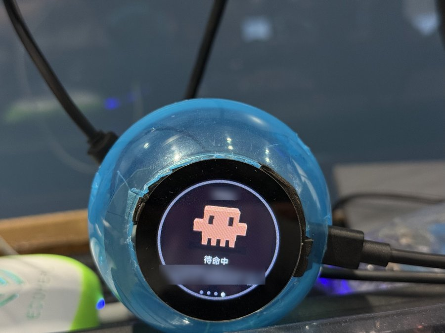
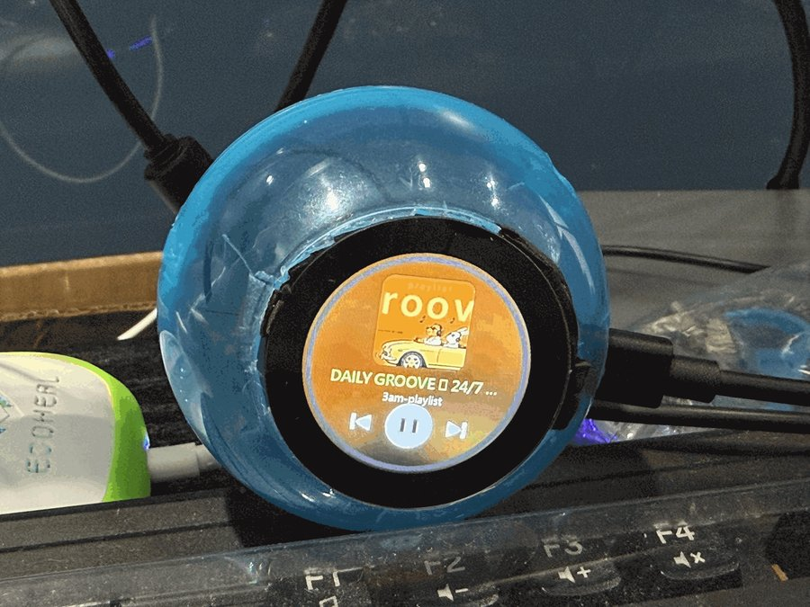
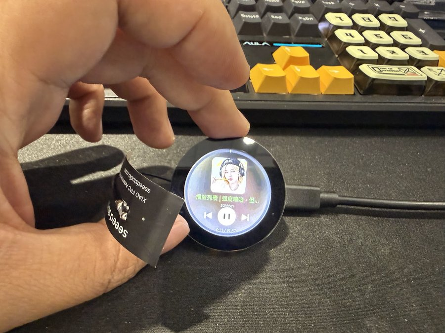
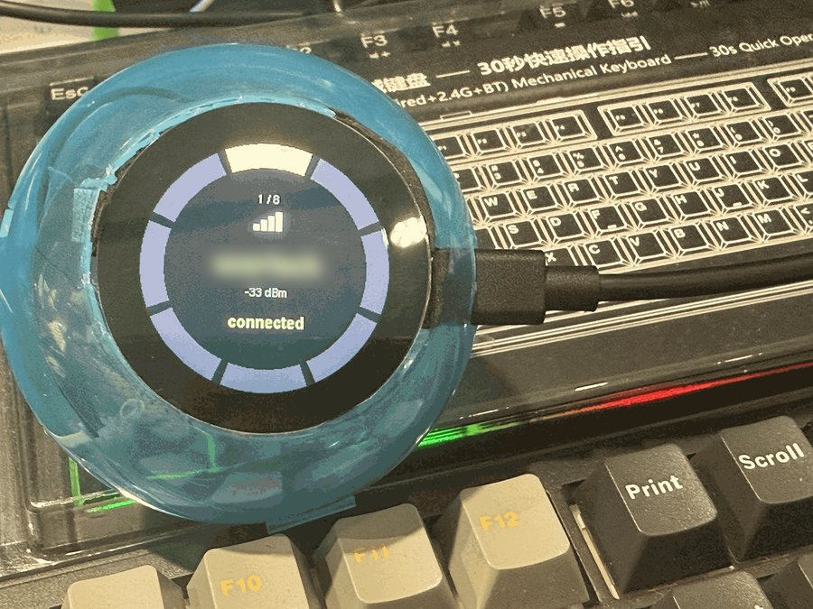
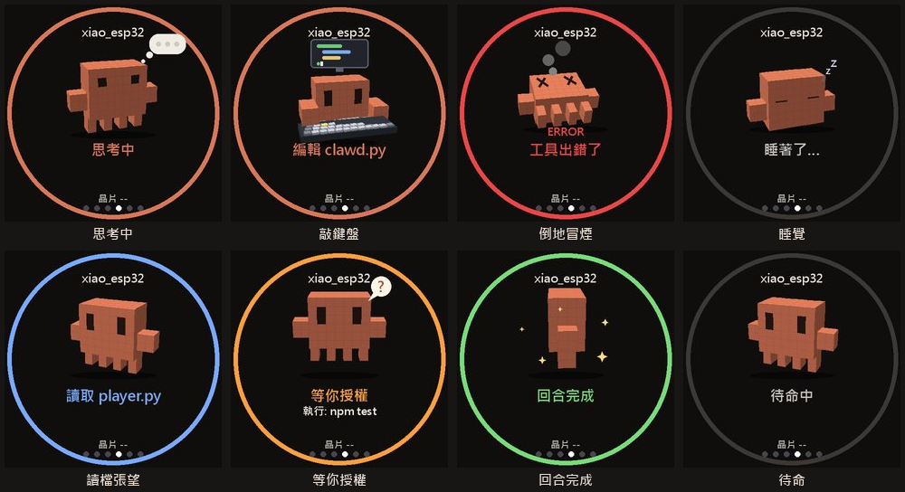
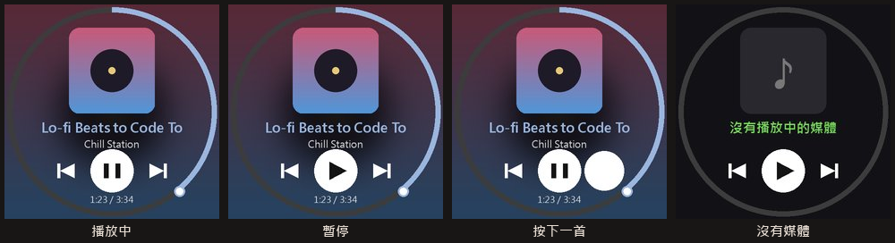
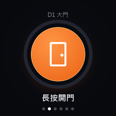
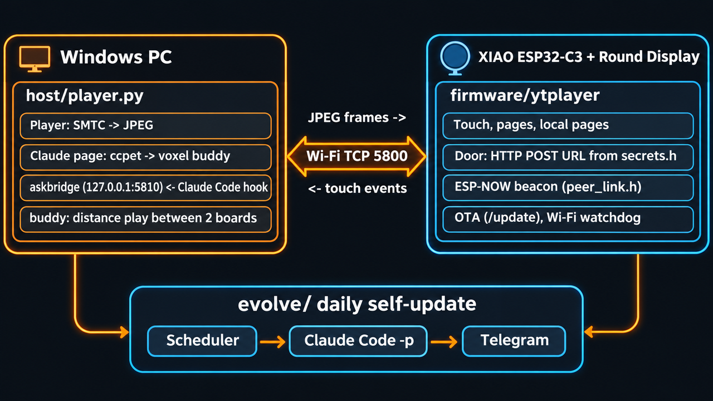

# xiao-cc-pet: a Claude Code buddy on a tiny round screen

[繁體中文](README.md) | **English**

A desk gadget built from a XIAO ESP32-C3 and a Seeed Round Display (1.28-inch round touch screen), housed in a gacha capsule.
The Windows PC draws the screens in Python and pushes them to the board; the board handles touch, Wi-Fi, a door button and a few pages it draws itself.
The fun part: every morning it **proposes a redesign of itself**, and you apply it by replying one word on Telegram.

> This is the public cut of a personal project. Secrets (Wi-Fi password, OTA password, door link, Telegram token) are not in the repo;
> bring your own `secrets.h` and `.env`, see [What you need to provide](#what-you-need-to-provide).

## Photos

| | |
|---|---|
|  |  |
| In its gacha capsule, the Claude buddy on standby | Player page: whatever the PC is playing |
|  |  |
| Before the capsule, driven by a fingertip | Wi-Fi page: turn the outer ring to pick a network, shows signal strength |

## Features

| Feature | What it does |
|---|---|
| **Player page** | The PC reads Windows media controls (SMTC) and renders cover art, title and progress as a JPEG for the board; tap to play / pause / skip, press and drag the progress ring to seek |
| **Claude page (3D voxel buddy)** | Follows Claude Code live: thinking, typing, reading files, waiting for your approval, turn done, tool error (it falls over)… one animation per state |
| **Answer Claude's questions on the little screen** | When Claude Code asks a multiple-choice question (AskUserQuestion), it also shows up on the round screen; turn the ring to answer. At night it becomes a Telegram button card instead |
| **One link button (door page)** | Hold the center button and the board POSTs a URL directly (we use it to open the office door); "can't connect" and "rejected" get different pictures |
| **Wi-Fi** | Remembers up to 5 networks, pick one by turning the ring; add a new network by scanning a QR code with your phone and typing the password on the board's setup hotspot; a 2.4 GHz channel chart helps you pick a channel |
| **ESP-NOW play** | Two ESP32s broadcast to each other and use signal strength as distance: too close and they say hi, fight or complain about the heat; far away they say "signal's weak"; out of range they go looking |
| **Daily self-evolution** | At 04:00 Claude Code looks at holidays and design inspiration, edits a copy and renders a preview; at 09:30 it asks you on Telegram, reply "小圓盤 更新 P-…" and it applies itself (OTA if needed) |
| Night mode, temperature page, system page | Screen off after 30 s untouched at night; chip temperature trend; Wi-Fi / IP / uptime |
| Wi-Fi watchdog, OTA | Reconnects after 30 s offline, reboots after longer and records why; firmware updates over Wi-Fi |

## Screens

Claude page (rendered):



Player page:



Door page:



## Architecture



<details>
<summary>Text version</summary>

```
             Wi-Fi TCP 5800 (JPEG frames ↓, touch events ↑)
 Windows PC ───────────────────────────────── XIAO ESP32-C3 + round display
  host/player.py                                firmware/ytplayer/
   ├ player: SMTC → JPEG                          ├ touch, paging, pages it draws (door / system / Wi-Fi / night)
   ├ Claude page: ccpet state → voxel buddy       ├ door: HTTP POST to the URL in secrets.h
   ├ askbridge (127.0.0.1:5810) ← Claude Code hook├ ESP-NOW beacon (peer_link.h)
   └ buddy: distance play between two boards      └ OTA (/update), Wi-Fi watchdog
 evolve/  daily self-evolution (scheduler → Claude Code -p → Telegram)
```

</details>

- The Claude page state comes from [ccpet](#dependencies) (a separate project, port 3378), which reads the JSONL under `~/.claude/projects`.
- The board advertises mDNS `xiao-player.local`; `player.py` finds it by itself.

## How the daily self-evolution talks to Claude Code

1. `evolve/register-tasks.ps1` registers two Windows Task Scheduler jobs: `survey` at 04:00 and `ask` at 09:30 (launched through a hidden VBS, no window flash).
2. `evolve/survey.py`:
   - picks a theme with `holidays.py` (Taiwan and international holidays, lunar dates via lunardate);
   - copies the files it may change into `evolve/proposals/P-<date>-<page>/` and runs
     `claude -p --output-format json --permission-mode acceptEdits --allowedTools … --disallowedTools …` inside that copy,
     so Claude can only edit the copy, never the live code;
   - compiles, renders a preview with the real code, and writes `manifest.json` (the SHA-256 of every file before the change).
3. `evolve/ask.py` sends the ready proposal and preview to Telegram.
4. You reply "小圓盤 更新 / 跳過 / 還原 P-…" (update / skip / revert), and `evolve/apply.py`:
   - checks the SHA-256 first and refuses if a live file changed after the proposal;
   - backs up → overwrites → OTA if needed → restarts `player.py` → sends a screenshot of the result; a failed OTA rolls back automatically.

**It uses the Claude Code you are already logged into** (`claude login`); no API key is needed or used.
The login credentials live under `~/.claude/`, not in this repo.

### Answering Claude's questions on the little screen (hook)

In the project's `.claude/settings.local.json` (not in git, create your own):

```json
{
  "hooks": {
    "PreToolUse": [
      {
        "matcher": "AskUserQuestion",
        "hooks": [{ "type": "command", "command": "python <repo>/host/device_answer.py", "timeout": 340 }]
      }
    ]
  }
}
```

`device_answer.py` sends the question to `player.py` (127.0.0.1:5810) and waits for the answer; if the board doesn't answer or anything fails,
it simply exits and the terminal asks you as usual, so Claude Code never hangs.

## What you need to provide

| File | Contents | Template |
|---|---|---|
| `firmware/ytplayer/secrets.h` | Wi-Fi SSID / password, door URL, OTA user / password | `secrets.h.example` |
| Telegram `.env` | `TELEGRAM_BOT_TOKEN=`, `TELEGRAM_CHAT_ID=` | point the `XIAO_TG_ENV` environment variable at it |

Other machine-specific paths can be changed with environment variables: `XIAO_CLAUDE` (claude.exe), `XIAO_BASH` (Git Bash).

## Install

1. Install [arduino-cli](https://arduino.github.io/arduino-cli/) as `tools/arduino-cli.exe`; add esp32 core 3.3.x and the libraries `GFX Library for Arduino`, `TJpg_Decoder`, `U8g2` (`qrcode.h` comes with the esp32 core).
2. First flash over USB: `sh flash.sh COM13`; after that over Wi-Fi: `sh flash.sh ota`.
   The partition scheme must be `min_spiffs` (the firmware is > 1.2 MB; two 1.9 MB slots are needed for OTA).
3. PC side uses [uv](https://docs.astral.sh/uv/): `start-xiao.bat` starts `player.py` (and ccpet) in the background; `stop-xiao.bat` stops them.
4. Daily evolution: run `evolve/register-tasks.ps1` in PowerShell.

## Dependencies

- **ccpet**: a small service that reads Claude Code session state (port 3378); the Claude page needs it, everything else works without it.
- ESP-NOW play needs a second ESP32 running `peer_link.h` (on the same Wi-Fi channel).

## Secret check

`tools/check_secrets.py` reads your local `secrets.h` and Telegram `.env` and scans the files about to be committed for those values;
it also blocks `secrets.h`, `.env` and `*.bin`. Install it as a git hook:

```sh
git config core.hooksPath .githooks
```

## Come play with MF AI 開搞!

This little round screen was made by us, **MF AI 開搞** 🙌
Every day we hack on something with AI: videos, songs and music videos, and desk toys like this gacha capsule.
We share how we build things, the pitfalls we hit and new tricks on our page and channel first. Follow us, leave a comment and come play along!

- ▶️ YouTube: [MF AI 開搞](https://www.youtube.com/channel/UCGDR4quVMcfCoUJmNFNRGuA/)
- 👍 Facebook page: [MF AI 開搞](https://www.facebook.com/61594628407625/)

Questions, requests, or built your own version? Tell us on the Facebook page!

## Credits

The voxel buddy's look is a tribute to Anthropic's mascot Clawd; this is a personal project with no affiliation with Anthropic.
