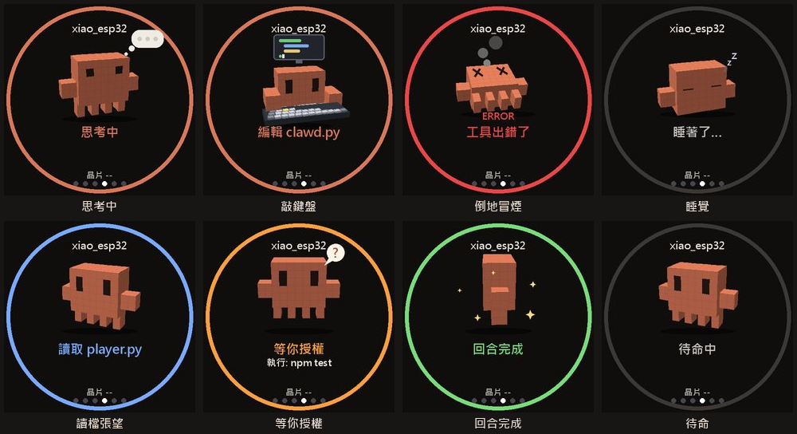
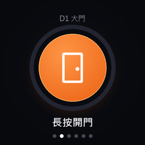

# xiao-cc-pet：XIAO 圓形小螢幕上的 Claude Code 小夥伴

XIAO ESP32-C3 ＋ Seeed Round Display（1.28 吋圓形觸控）做成的桌上小裝置，裝在扭蛋殼裡。
電腦端（Windows）用 Python 畫畫面、推給板子；板子負責觸控、Wi-Fi、開門和幾個自己畫的頁面。
最特別的是它每天清晨會**自己提一版改版**，你在 Telegram 回一個字就套用。

> 這是個人專案的公開整理版：機密（Wi-Fi 密碼、OTA 密碼、開門連結、Telegram token）都不在 repo 裡，
> 自己準備一份 `secrets.h` 和 `.env` 才能跑，見「[要自己準備的東西](#要自己準備的東西)」。

## 功能

| 功能 | 說明 |
|---|---|
| **播放器頁** | 電腦讀 Windows 的媒體控制（SMTC），把封面、歌名、進度畫成 JPEG 推給板子；板子上點按鈕就能播放／暫停／換首，按住進度條拖曳 |
| **Claude 頁（3D 體素小橘人）** | 讀 Claude Code 的即時狀態：思考中、敲鍵盤、讀檔、等你授權、回合完成、出錯倒地… 每種狀態一個動作 |
| **在小螢幕回答 Claude 的問題** | Claude Code 問選擇題（AskUserQuestion）時，題目同時出現在小螢幕上，轉外圈選答案；晚上改成 Telegram 按鈕卡片 |
| **加一個連結（開門頁）** | 按住中間的鈕，板子直接 POST 一個網址（我們用來開辦公室的門）；連不上和被拒絕會畫不同的圖 |
| **連 Wi-Fi** | 最多記 5 組網路，轉外圈挑網路；新網路用手機掃 QR 連上板子的設定熱點輸入密碼；還有 2.4 GHz 頻道圖幫你挑頻道 |
| **ESP-NOW 互動** | 跟另一塊 ESP32 互相廣播，用訊號強度判斷距離：太靠近會打招呼、打架、喊熱，拉遠會說「訊號好弱」，聽不到會找人 |
| **每日自我進化** | 每天 04:00 Claude Code 看節日與設計靈感，在副本裡改一版、渲染預覽；09:30 送到 Telegram 問你，回「小圓盤 更新 P-…」就自動套用（必要時 OTA） |
| 夜間模式、溫度頁、系統頁 | 夜裡沒碰 30 秒熄屏；晶片溫度趨勢；Wi-Fi／IP／開機時間 |
| Wi-Fi 看門狗、OTA | 斷線 30 秒重連、更久自動重開機並記下原因；韌體走 Wi-Fi 更新 |

## 畫面

Claude 頁（正式程式離線渲染，資料是假的）：



播放器頁：


開門頁：



<!-- 實機照片：Wi-Fi 頁、ESP-NOW 互動、Telegram 提問卡片、每日進化提案。檔案放 docs/images/ 再在這裡加上 -->

## 架構

```
             Wi-Fi TCP 5800（JPEG 畫面 ↓、觸控事件 ↑）
 Windows 電腦 ──────────────────────────────── XIAO ESP32-C3 ＋ 圓形螢幕
  host/player.py                                firmware/ytplayer/
   ├ 播放器：SMTC → JPEG                          ├ 觸控、換頁、自己畫的頁（開門／系統／Wi-Fi／夜間）
   ├ Claude 頁：ccpet 狀態 → 體素小橘人            ├ 開門：直接 HTTP POST secrets.h 裡的網址
   ├ askbridge（127.0.0.1:5810）← Claude Code hook ├ ESP-NOW 信標（peer_link.h）
   └ buddy：兩塊板子的距離互動                      └ OTA（/update）、Wi-Fi 看門狗
 evolve/  每日自我進化（排程器 → Claude Code -p → Telegram）
```

- Claude 頁的狀態來自 [ccpet](#相依)（另一個專案，port 3378），它讀 `~/.claude/projects` 的 JSONL。
- 板子用 mDNS `xiao-player.local`，`player.py` 會自己找到它。

## 每日自我進化是怎麼接上 Claude Code 的

1. `evolve/register-tasks.ps1` 在 Windows 工作排程器註冊兩個工作：04:00 `survey`、09:30 `ask`（用隱藏 VBS 啟動，不閃視窗）。
2. `evolve/survey.py`：
   - 用 `holidays.py`（台灣＋國際節日，農曆用 lunardate 算）挑主題；
   - 把要改的檔案複製到 `evolve/proposals/P-<日期>-<頁>/`，在那個副本裡跑
     `claude -p --output-format json --permission-mode acceptEdits --allowedTools … --disallowedTools …`，
     Claude 只能改副本，碰不到正式程式；
   - 改完編譯檢查、用正式程式渲染預覽，寫 `manifest.json`（每個檔案記下改版前的 SHA-256）。
3. `evolve/ask.py`：把準備好的提案和預覽圖送到 Telegram。
4. 你回「小圓盤 更新／跳過／還原 P-…」，`evolve/apply.py`：
   - 先比對 SHA-256，正式檔案在提案後被改過就拒絕；
   - 備份 → 覆蓋 → 要的話 OTA → 重啟 `player.py` → 送一張套用後的截圖；OTA 失敗自動還原。

**用的是你本機已登入的 Claude Code**（`claude login`），不需要也不會用到 API key；
登入憑證在 `~/.claude/` 底下，不在這個 repo 裡。

### 在小螢幕回答 Claude 的問題（hook）

專案的 `.claude/settings.local.json`（不進 git，自己建）：

```json
{
  "hooks": {
    "PreToolUse": [
      {
        "matcher": "AskUserQuestion",
        "hooks": [{ "type": "command", "command": "python <repo>/host/device_answer.py", "timeout": 340 }]
      }
    ]
  }
}
```

`device_answer.py` 把題目送到 `player.py`（127.0.0.1:5810）等答案；板子沒回答或任何失敗都直接結束，
終端機照常問你，不會卡住 Claude Code。

## 要自己準備的東西

| 檔案 | 內容 | 範本 |
|---|---|---|
| `firmware/ytplayer/secrets.h` | Wi-Fi SSID／密碼、開門網址、OTA 帳密 | `secrets.h.example` |
| Telegram `.env` | `TELEGRAM_BOT_TOKEN=`、`TELEGRAM_CHAT_ID=` | 用環境變數 `XIAO_TG_ENV` 指到它 |

其他機器相依的路徑都能用環境變數改：`XIAO_CLAUDE`（claude.exe）、`XIAO_BASH`（Git Bash）。

## 安裝

1. 安裝 [arduino-cli](https://arduino.github.io/arduino-cli/)，放到 `tools/arduino-cli.exe`；裝 esp32 core 3.3.x 和函式庫 `GFX Library for Arduino`、`TJpg_Decoder`、`U8g2`（`qrcode.h` 用 esp32 core 內建的）。
2. 第一次用 USB 燒：`sh flash.sh COM13`；之後走 Wi-Fi：`sh flash.sh ota`。
   分割表一定要 `min_spiffs`（韌體 > 1.2 MB，兩個 1.9 MB 槽才能 OTA）。
3. 電腦端用 [uv](https://docs.astral.sh/uv/)：`start-xiao.bat` 會在背景啟動 `player.py`（和 ccpet）；`stop-xiao.bat` 停止。
4. 每日進化：PowerShell 跑 `evolve/register-tasks.ps1`。

## 相依

- **ccpet**：讀 Claude Code session 狀態的小服務（port 3378），Claude 頁需要它；沒有它其他頁照常運作。
- ESP-NOW 互動要另一塊跑 `peer_link.h` 的 ESP32（同一個 Wi-Fi 頻道）。

## 機密檢查

`tools/check_secrets.py` 會讀你本機的 `secrets.h` 和 Telegram `.env`，掃要 commit 的檔案裡有沒有出現那些值，
另外擋 `secrets.h`、`.env`、`*.bin`。裝成 git hook：

```sh
git config core.hooksPath .githooks
```

## 來 MF AI 開搞玩！

這顆小圓盤就是我們「MF AI 開搞」做的 🙌
我們每天都在用 AI 開搞各種東西：做影片、寫歌拍 MV、還有像這顆扭蛋一樣的桌上小玩具。
做的過程、踩過的坑、新玩法，都會先分享在粉絲團和頻道，歡迎來追蹤、留言跟我們一起玩！

- ▶️ YouTube：[MF AI 開搞](https://www.youtube.com/channel/UCGDR4quVMcfCoUJmNFNRGuA/)
- 👍 Facebook 粉絲團：[MF AI 開搞](https://www.facebook.com/61594628407625/)

有問題、想要我們做什麼，或做出了自己的版本，都歡迎到粉絲團告訴我們！

## 致謝

小橘人的造型致敬 Anthropic 的吉祥物 Clawd；這是個人作品，與 Anthropic 無關。
